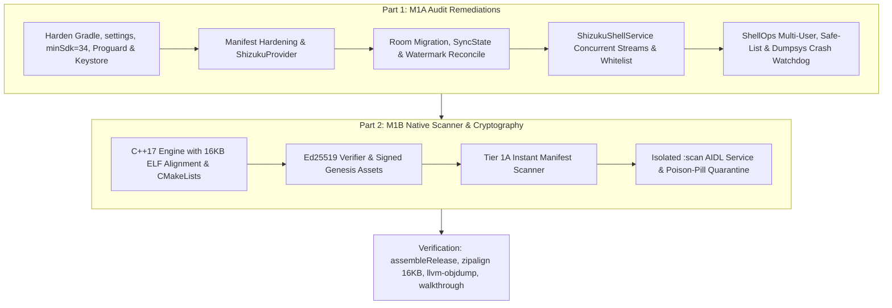

# Implementation Plan: Milestone 1A Complete Audit Remediation & Milestone 1B Native Engine

## 1. Executive Summary & Architecture Scope
This implementation plan addresses two critical objectives in strict compliance with `GEMINI.md`, `AUDIT_RULES.md`, and `docs/architecture.md`:
1. **Part 1: Milestone 1A Complete Audit Remediations:**
   Hardens the project build, removes unscoped repositories, sets `minSdk = 34` (Android 14–16 exclusively), introduces a dedicated local release keystore, strips release logging, declares `rikka.shizuku.ShizukuProvider` while stripping third-party exported receivers (`ProfileInstallReceiver`, `DiagnosticsReceiver`, `WorkManagerInitializer`), secures Room optimistic locking and concurrency with non-destructive migrations, hardens `ShizukuShellService` and `ShizukuManager` against OOM/Binder leaks, expands the critical safe-list, corrects multi-user and UID firewall isolation, and makes the 60-second crash watchdog durable and privileged via shell dumpsys.
2. **Part 2: Milestone 1B Tier 1A + Isolated `:scan` C++17 NDK 16KB Engine:**
   Implements an isolated secondary process (`android:process=":scan"`, `android:exported="false"`) communicating via AIDL (`IScanService`), paired with a C++17 zero-copy `mmap` engine linked with 16 KB ELF segment alignment (`-Wl,-z,max-page-size=16384`), Ed25519-verified tracker/model assets (`Signature.getInstance("Ed25519")`), atomic poison-pill quarantine (quarantining APKs after 2 crashes), streaming zlib decompression with a 64 MB cap against ZIP bombs, and multi-framework Aho-Corasick static triage.

---

## 2. File & Component Architecture

### Part 1 Files (Modified & Hardened)
- `android/settings.gradle.kts`: Strip unscoped Xposed Maven repository; rely strictly on `mavenCentral()` and `google()`.
- `android/app/build.gradle.kts`:
  - Set `minSdk = 34`, `targetSdk = 35`, `compileSdk = 35`.
  - Add Room schema export argument: `ksp { arg("room.schemaLocation", "$projectDir/schemas") }`.
  - Configure release signing with dedicated auto-generated local keystore (`keystore/release.jks`, gitignored).
  - Configure CMake external native build pointing to `src/main/cpp/CMakeLists.txt` with NDK r28+ (`28.0.13004108`).
  - Add linker flags `-Wl,-z,max-page-size=16384` and `-Wl,-z,common-page-size=16384`.
- `android/app/proguard-rules.pro`: Strip `Log.v`, `Log.d`, `Log.i`, and `Log.w` calls in release builds via `-assumenosideeffects`.
- `android/app/src/main/AndroidManifest.xml`:
  - Declare `rikka.shizuku.ShizukuProvider` with `android:permission="android.permission.INTERACT_ACROSS_USERS_FULL"`.
  - Strip `ProfileInstallReceiver` and `DiagnosticsReceiver` using `tools:node="remove"`.
  - Remove default `WorkManagerInitializer` from `InitializationProvider` via `tools:node="remove"`.
  - Declare `ScanService` under `android:process=":scan"` with `android:exported="false"`.
- `android/app/src/main/java/org/privacyguard/android/PrivacyGuardApp.kt`:
  - Implement `Configuration.Provider` for on-demand WorkManager initialization.
  - Register dynamic receivers with `Context.RECEIVER_NOT_EXPORTED`.
  - Ensure secondary processes (`:scan`, `:shizuku`) return immediately in `onCreate()`.
- `android/app/src/main/java/org/privacyguard/android/data/AppDatabase.kt`:
  - Set `exportSchema = true` and remove `.fallbackToDestructiveMigration()`.
  - Define `MIGRATION_1_2` adding `lastCrashAt` to `scan_failed`, unique index to `policy_op`, and creating `sync_state` table for boot count & delta sequences.
- `android/app/src/main/java/org/privacyguard/android/data/entity/PolicyOp.kt` & `PolicyOpDao.kt`:
  - Composite unique index `[pkg, op, target]`.
  - Atomic claim: `UPDATE policy_op SET status = 'APPLYING', gen = gen + 1, nextAt = :leaseUntilMs WHERE id = :id AND gen = :expectedGen AND status IN ('PENDING', 'FAILED_TRANSIENT')`.
  - Remove raw `@Update` and remove `'DRIFT'` from runnable ops; add state transition helpers returning affected row count.
- `android/app/src/main/java/org/privacyguard/android/data/entity/SyncState.kt` & `SyncStateDao.kt`:
  - Track `bootCount` and `lastSequenceNumber` in SQLite.
- `android/app/src/main/java/org/privacyguard/android/data/dao/ReconcileRequestDao.kt` & `ReconciliationCoordinator.kt`:
  - Watermark-based deletion (`DELETE WHERE pkg = :pkg AND requestedAt <= :processedAt`).
  - Mutex-guarded execution and boot count check via `Settings.Global.BOOT_COUNT`.
- `android/app/src/main/java/org/privacyguard/android/data/dao/ScanFailedDao.kt`:
  - Atomic SQLite upsert `ON CONFLICT(pkg, versionCode) DO UPDATE SET crashCount = crashCount + 1, lastCrashAt = :now`.
- `android/app/src/main/java/org/privacyguard/android/shizuku/ShizukuShellService.kt`:
  - Binary whitelist (`cmd`, `pm`, `am`, `dumpsys`).
  - Immediate `outputStream.close()`.
  - Concurrent bounded streaming (256 KB cap per stream) and 10s process timeout.
- `android/app/src/main/java/org/privacyguard/android/shizuku/ShizukuManager.kt`:
  - `@Volatile` service reference and serialized execution on `Dispatchers.IO.limitedParallelism(1)`.
  - Accurate `activeGen` tracking and structured error classification (`SecurityException` -> `FAILED_PERMANENT`, transient Binder failure -> backoff retry).
- `android/app/src/main/java/org/privacyguard/android/shizuku/ShellOps.kt`:
  - Corrected GSF package name (`com.google.android.gsf`), protected system apps (`FLAG_SYSTEM`), own package, and WorkManager internals.
  - Dynamic discovery of Firebase/GMS intent handlers via `queryIntentServices` and `queryIntentReceivers`.
  - Multi-user UID calculation (`appInfo.uid / 100000`) and shared UID bypass (`UNISOLATABLE_ON_WIFI`).
  - Pre-mutation snapshot persistence in Room and rollback on read-back mismatch.
- `android/app/src/main/java/org/privacyguard/android/work/CrashWatchdogWorker.kt`:
  - Privileged crash detection via `ShizukuShellService` running `dumpsys activity exit-info <pkg>`.
  - Pass only `opId` in `WorkData` and load snapshot from Room.
  - Execute rollback via shell `pm enable --user $userId` on crash.

### Part 2 Files (Milestone 1B New Components)
- `android/app/src/main/cpp/CMakeLists.txt`:
  - CMake build script targeting C++17, linking `-lz` and `-llog`, enforcing 16 KB page alignment.
- `android/app/src/main/cpp/apk_mmap.hpp`:
  - POSIX `mmap` wrapper reading ZIP central directory with `sysconf(_SC_PAGESIZE)` alignment and bounds validation.
- `android/app/src/main/cpp/aho_corasick.hpp`:
  - High-performance memory-efficient Aho-Corasick automaton for string search.
- `android/app/src/main/cpp/scanner_jni.cpp`:
  - JNI bridge extracting DEX strings, ELF imports, Flutter notices, Hermes bytecode, and Unity metadata.
- `android/app/src/main/aidl/org/privacyguard/android/scan/NativeScanResult.aidl`:
  - Parcelable declaration for native scan output.
- `android/app/src/main/aidl/org/privacyguard/android/scan/IScanService.aidl`:
  - AIDL interface for IPC between main process and `:scan` process.
- `android/app/src/main/java/org/privacyguard/android/scan/NativeScanResult.kt`:
  - Parcelable data class encapsulating features, matched tracker IDs, and entropy scores.
- `android/app/src/main/java/org/privacyguard/android/scan/ScanService.kt`:
  - Bound service in `android:process=":scan"`.
- `android/app/src/main/java/org/privacyguard/android/scan/ScanOrchestrator.kt`:
  - Main process coordinator handling poison-pill quarantine and `:scan` IPC.
- `android/app/src/main/java/org/privacyguard/android/scan/tier1a/Tier1AScanner.kt`:
  - Instant manifest scanner extracting permissions, signing cert hashes, and component prefixes under 5 ms.
- `android/app/src/main/java/org/privacyguard/android/crypto/Ed25519Verifier.kt`:
  - Java `Signature.getInstance("Ed25519")` validator verifying `.sig` files against pinned public key.
- `android/app/src/main/assets/`:
  - `trackers_ac.bin` & `trackers_ac.bin.sig`
  - `lgbm_model.bin` & `lgbm_model.bin.sig`
  - Deterministically signed offline genesis rule files.

---

## 3. Step-by-Step Implementation Strategy

---

## 4. Verification & Validation Protocol
1. **Compilation & Release Build:**
   `.\gradlew.bat assembleRelease --stacktrace` must succeed with zero errors, compiling C++ JNI code with NDK r28 and shrinking code via R8.
2. **Manifest Attack Surface Audit:**
   Inspect merged manifest in `app/build/intermediates/merged_manifests/release/processReleaseManifest/AndroidManifest.xml`:
   Verify that **only** `MainActivity` and `rikka.shizuku.ShizukuProvider` are exported. All other components (`ScanService`, receivers, WorkManager) must be unexported or stripped.
3. **16 KB Alignment Check:**
   `zipalign -c -P 16 -v 4 app-release.apk` must report `Verification succesful` and confirm `lib/arm64-v8a/libprivacyguard_scan.so` is aligned.
4. **ELF Segment 16 KB Verification:**
   Run `llvm-readobj -l` or `llvm-objdump -p` from NDK toolchain on `libprivacyguard_scan.so` to confirm `LOAD` segment `Align` equals `0x4000` (16384).
5. **Walkthrough Documentation:**
   Write full report in `walkthrough.md` per `GEMINI.md` standards.
